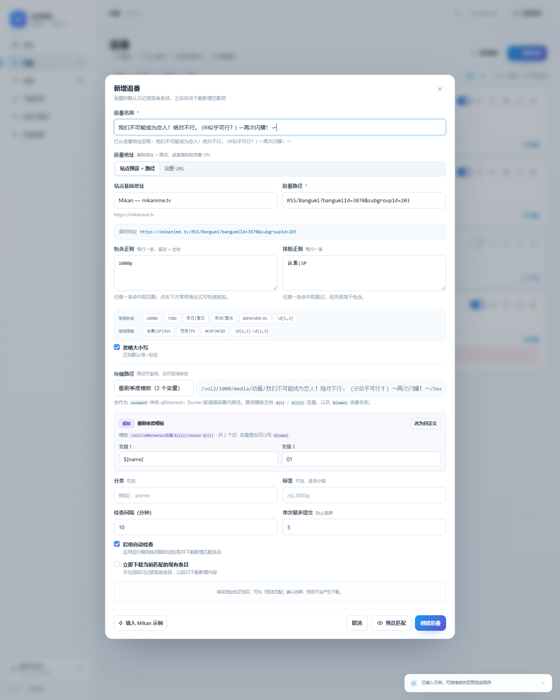
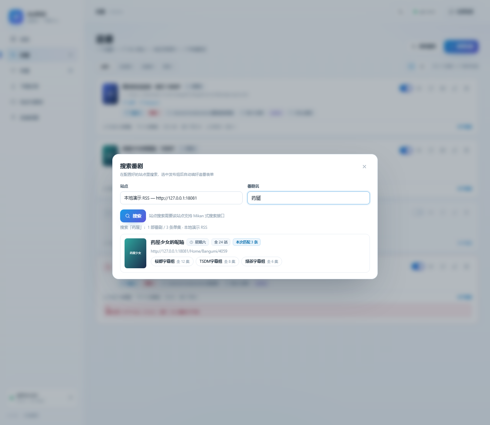

# AniRSS · 追番台

> **Ani**me + **RSS**：把 RSS 追番变成自动下载。零 npm 依赖的自托管 Web 应用——按「站点基础地址 + 追番路径」拼出 RSS，用正则筛选标题，自动提交到 qBittorrent；另有站点搜索快速追番、集数识别、磁力/种子单次补番。


默认浅色主题，可切换深色；可独立运行，也可打包成 fnOS（飞牛）应用，在浏览器里用独立端口打开。


## 主要功能

- **自动追番**：RSS / Atom → 包含与排除正则 → 自动提交 qBittorrent，只下载新增且匹配的条目。
- **站点搜索快速追番**：在配置好的站点里搜番剧，选定番剧 + 发布组后自动填好站点、追番地址和名称，发布组显示按字幕组 RSS 统计的**真实集数**。
- **存储路径预设与模板**：`${1}` 变量 + `${name}` 追番名称，套用时只填空，最终路径作为 `savepath` 传给 qB。
- **补番**：磁力链接（支持多行）或 `.torrent` 文件单次下载，与追番共用同一套路径预设。
- **补番硬链接**：下载完成后自动挑出**正片 + 对应字幕**，跳过 CDs、Scans、NCOP 等，按季号平铺到 `…/Season n/`；目标直接复用「站点与路径」预设，源文件保留继续做种。
- **外挂字幕库**：补番卡片上可以批量上传字幕/字体文件或 zip/tar 压缩包（自动解压、保留目录层级），也可以贴直链让应用自己下载；入库的字幕与种子内字幕一起参与集数配对和重命名，硬链接时一起进媒体库。
- **集数识别**：从文件名 / 种子名猜集数（`S01E02`、`第 12 集`、`[12]`、`- 07`、`01-12 合集`、`NCOP` 等），并标注在追番预览、补番记录和下载记录上。
- **看得见的状态**：列表 / 封面两种视图、预览抽屉（匹配原因、是否已见、是否已提交）、下载记录与失败重试、qBittorrent 状态面板；后台状态原地更新，不整页刷新、不打断输入，切页后未提交的表单也会保留。
- **网络代理**：HTTP / HTTPS / SOCKS5，只作用于本应用的出站请求（RSS、种子、封面）。
- **零依赖**：只用 Node.js 内置模块，Node 18+ 即可运行。

## 快速开始

### 方式一：fnOS（飞牛）应用

1. 在 fnOS 应用中心开启「手动安装」。
2. 安装 `anirss-1.11.0.fpk`（依赖 `nodejs_v24`，应用中心会自动处理）。
3. 点击桌面上的「AniRSS 追番台」，系统浏览器会打开 `http://<NAS-IP>:18181/`。

数据目录是 `$TRIM_PKGVAR`（通常在 `/vol1/@appdata/anirss/`）；卸载默认保留数据。

### 方式二：本机独立运行（Windows / Linux / macOS）

需要 Node.js 18 或更新版本。

```bash
# Windows：双击 start.cmd，或
node app/server/index.js

# Linux / macOS
bash start.sh
```

默认打开 <http://127.0.0.1:8777>。

| 环境变量 | 默认 | 说明 |
| --- | --- | --- |
| `ANIRSS_PORT` | `8777`（独立）/ `18181`（fnOS） | 监听端口；设为 `0` 可关闭 TCP |
| `ANIRSS_HOST` | `127.0.0.1`（独立）/ `0.0.0.0`（fnOS） | 监听地址 |
| `ANIRSS_DATA` | `./data` | 配置与历史数据目录 |
| `ANIRSS_SOCKET` | 空 | Unix Socket 路径（fnOS 网关用） |

## 用法

**1. 连接 qBittorrent** — 「连接设置」填 WebUI 地址（同机一般是 `http://127.0.0.1:8080`），点「保存并测试」。成功后可以一键把 qB 的默认保存路径加为路径预设。

**2. 添加站点基础地址** — 「站点与路径 → 站点基础地址」填站点根地址，例如 `https://mikanime.tv`。默认已带一个可编辑的 Mikan 预设。

**3. 新增追番** — 「追番 → 新增追番」：

- **追番地址** = 站点基础地址 + 路径，例如 `RSS/Bangumi?bangumiId=3870&subgroupid=203`；也可以切到「完整 URL」直接粘贴整条地址。
- **追番名称** 会根据地址自动获取，也可以自己改。
- **包含正则 / 排除正则**：每行一条，任意一条命中即生效，排除优先；留空表示全收。
- **存储路径**：选预设或直接填，留空则用 qBittorrent 默认路径。
- **检查间隔**（默认 10 分钟）与**单次最多提交**（默认 5 条）。



默认**只记录现有条目不补下历史**；想补下已有条目，勾选「立即下载当前匹配的现有条目」，或之后在卡片上点「补下现有」。

**4. 日常使用** — 应用按间隔自动检查并下载；追番卡片上可以暂停 / 启用、立即检查、编辑、删除，点卡片打开预览抽屉：

- 抽屉里能看到每条 RSS 的匹配原因、是否已见、是否已提交，也可以手动「下载」单条；
- 「下载记录」里失败的条目可以「重试」，qB 里删掉任务后可以「允许重下」，抽屉里对应的条目也有「重新下载」；
- 「补番」页粘贴磁力链接或上传 `.torrent` 做单次下载，可用「集数识别」小工具批量猜文件名集数。



## 补番硬链接

qBittorrent 把一部番下载到 `/volume1/downloads/葬送的芙莉莲`（里面可能是一个种子文件夹，也可能视频直接躺在这层），你只想要正片和字幕进媒体库。在「补番 → 硬链接设置」里确认链接内容是「正片 + 字幕」，新增补番时填好**名称**和**季**，硬链接目标直接选「站点与路径」里的预设即可：

**外挂字幕**：种子没带字幕时，点补番卡片上的「字幕」按钮——可以**批量上传**字幕/字体文件，也可以上传 **zip / tar / tar.gz 压缩包**（自动解压，保留包内目录层级，GBK 文件名的中文包也能正确识别；rar/7z 需要先转成 zip），或者贴一个 **http 直链**让应用自己下载（≤ 96MB）。非字幕/字体文件会自动跳过；入库的字幕和种子内字幕走同一套集数配对与重命名逻辑，补番已下载完成时会立即重新硬链接，应用数据目录和媒体库不在同一分区时小文件自动改为复制。

```text
下载：/volume1/downloads/葬送的芙莉莲/[VCB-Studio] 葬送的芙莉莲 [01][Ma10p_1080p].mkv
      /volume1/downloads/葬送的芙莉莲/[VCB-Studio] 葬送的芙莉莲 [01][Ma10p_1080p].ass
      /volume1/downloads/葬送的芙莉莲/CDs/...  /volume1/downloads/葬送的芙莉莲/Scans/...

目标：/volume1/media/动画/葬送的芙莉莲/Season 1/
        [VCB-Studio] 葬送的芙莉莲 [01][Ma10p_1080p].mkv
        [VCB-Studio] 葬送的芙莉莲 [01][Ma10p_1080p].ass
```

- **目标直接用路径预设**：在「补番 → 硬链接到」里选「站点与路径」的预设即可，和保存路径同一套；预设里的 `${name}`、`${season}` 会替换成名称和季，数字变量（`${1}`、`${{}}`）按「第 1 个 = 名称、第 2 个 = 季」填充，例如 `/vol2/1000/media/动画/${{1}}/Season ${{}}` 会变成 `/vol2/1000/media/动画/葬送的芙莉莲/Season 1`；
- **本次是否硬链接**：新增补番时可以取消「下载完成后硬链接」，目标模板会保留但不执行；卡片上的铅笔按钮可以随时开关，关闭后不再自动巡检，已经链接过去的文件不受影响；
- **按集数重命名 + 集数偏移**：勾选「按集数重命名」后，视频和字幕都会改成模板 `名称 - 集数`（默认 `${name} - ${episode2}`，可在硬链接设置里改）；视频和字幕可以各自设置 ±999 的偏移，**按目标集数配对**后再互相同名。例如下载是 01–12、目标是 13–24：视频偏移填 `12`、字幕偏移填 `0`（字幕本身是 13–24），得到 `某番剧 - 13.mkv` + `某番剧 - 13.ass`；如果字幕也是 01–12，字幕偏移同样填 `12`。一集多份字幕会自动加 `.zh`、`.zh-Hant`、`.ja` 后缀区分；
- **只挑正片 + 字幕**：正片按集数识别（`[01]`、`- 07`、`第 12 集`、`S01E02`、`EP12`、`Show - 13.ass`），跳过 `CDs/`、`Scans/`、`SP/`、`NCOP`、`NCED`、`PV`、`CM`、`Menu` 和 `01-12 合集` 这类；字幕按同名文件或目标集数匹配（`subs/` 目录里的也能认出来），一集多份字幕（简/繁/日）都会链接；
- **平铺到季目录**：目标目录 = 预设/模板渲染结果，文件不带种子内子目录直接放进去；同集有 1080p/720p 多个版本时保留路径最浅、体积最大的那个；
- **可选的镜像模式**：硬链接设置里的「链接内容」切到「全部文件（保持种子内相对路径）」，就回到按扩展名筛、保持种子目录结构的旧行为，可勾选「去掉种子顶层目录」；
- 不要的字幕/字体/特典可以在设置里改扩展名与排除词；勾「连同字体」会把 `fonts/` 链到 `目标/fonts/`；
- 使用前先授权目录：打开「应用设置 → 访问权限 → 添加」，把 qBittorrent 的**下载目录**和这里的**硬链接目录**都加进来并选「读写」（应用是独立用户运行的，没有授权就读不到这些文件）；fnOS 只能授权**已存在**的文件夹，季目录 `Season n` 由应用自己创建，不用手动建；
- 如果仍然提示无法创建目录，点「检查目录权限」会显示真正挡住的那层父目录、权限、属主和运行用户；授权对象应该是这层父目录（或先建好目标目录再授权它）；
- 硬链接不占额外空间，源文件继续做种；目标里已有同名文件时**不会覆盖**，直接跳过；
- 下载完成（进度 100%）后自动执行，关掉网页也会在后台每 30 秒巡检一次；卡片上的链接按钮可以手动重跑，重复执行只会补齐缺失的文件；铅笔按钮可以改目标模板、季、开关、重命名和集数偏移（留空目标 = 取消硬链接，已链接的文件保留）；
- 硬链接要求**目标目录和下载目录在同一文件系统**（同一存储空间 / 同一个 Docker 卷），跨分区会报错；Docker 版 qBittorrent 还要保证容器内路径映射到本机同一路径，否则会提示「下载目录在本机不存在或应用没有访问权限」；
- 删除补番记录或 qB 任务时，已经硬链接到媒体库的文件会保留。

## 存储路径模板

把变化的部分写成变量，套用预设时只填空：

| 写法 | 说明 |
| --- | --- |
| `${1}`、`${2}` | 推荐写法，按编号填写 |
| `${{1}}`、`${{}}` | 兼容写法，匿名变量按出现顺序编号 |
| `${name}` | 追番名称，自动替换；`/ \ : * ? " < > \|` 会换成 `_` |

```text
路径：/vol2/1000/media/动画/${{1}}/Season ${{}}
变量 1：葬送的芙莉莲    变量 2：01
最终路径：/vol2/1000/media/动画/葬送的芙莉莲/Season 01
```

`${name}` 不占变量编号，可以混用，**变量输入框里写 `${name}` 也会被替换**。

> 路径最终作为 qBittorrent 的 `savepath`：Docker 版要填**容器内路径**，不是 NAS 宿主机路径。

## 正则与集数识别

正则每行一条，JavaScript 语法，不要写 `/.../` 分隔符，默认忽略大小写，`#` 开头的行会跳过：

| 目的 | 示例 |
| --- | --- |
| 只要 1080p | `1080p` |
| 简日或繁日 | `简日\|繁日` |
| 第 1–12 集 | `\[(0?[1-9]\|1[0-2])\]` |
| 排除合集 / SP / OVA | `合集\|SP\|OVA`（填在排除框） |
| 指定字幕组 | `Lilith\|ANi\|桜都` |

表单里有「常用包含 / 常用排除」按钮可直接追加，保存前建议点「预览匹配」确认命中数量。

集数识别支持 `[12]`、`- 07`、`第 12 集`、`EP12`、`S02E05`、`01-12 合集`、`NCOP / OVA / SP01` 等常见写法，并会自动跳过 `1080p`、`HEVC-10bit`、`2025年10月番` 这类数字。

## 从旧版（qbrss / qB RSS 追番）升级

1.7.0 起项目更名为 AniRSS，fnOS 应用 id 由 `qbrss` 改为 `anirss`，对 fnOS 来说是一个**新应用**：

1. **先备份**：旧应用「连接设置 → 导出配置」下载 JSON，或复制旧数据目录 `/var/apps/qbrss/var/config.json`。
2. **停掉旧应用**（它占着 18181 端口），安装 `anirss-1.11.0.fpk`。
3. 新版首次启动会自动尝试从 `$QBRSS_DATA`、`/var/apps/qbrss/var`、旧项目旁的 `qbrss/data` 迁移配置，日志里会出现「已从旧数据目录迁移」；旧目录已删的话，用「连接设置 → 导入配置」导入第 1 步的 JSON。
4. 确认无误后再卸载旧应用。

环境变量已改为 `ANIRSS_*`，旧的 `QBRSS_*` 仍然兼容；配置格式与端口（18181）不变。

## 数据与安全

- 配置在 `$TRIM_PKGVAR/config.json`（fnOS）或 `$ANIRSS_DATA/config.json`（独立运行），以 `0600` 写入；建议定期用「导出配置」备份。
- 独立运行默认只监听 `127.0.0.1`；fnOS 版本用**独立端口 18181**，**不经过 fnOS 登录态**，任何能访问该端口的人都能改配置。请只在可信内网使用，不要做公网端口映射；需要外网访问就加一层带认证的反向代理。
- qBittorrent 与代理密码明文保存在本机配置文件里；「导出配置」不含密码，「导入配置」也不会读取密码。
- 建议给 qBittorrent 单独建一个权限受限的 WebUI 账号。

## 常见问题

**qBittorrent 拒绝添加（Fails.）**：多为保存路径或分类在 qB 侧不存在 / 不可写。Docker 版 qB 要填容器内路径，错误信息里会带上当前路径与分类。

**登录返回 403 / IP 被封禁**：qB 对失败登录有临时封禁，关闭「失败登录封禁」或等待解封。

**提示「返回的是网页而不是 RSS/Atom」**：该地址被登录页或 Cloudflare 拦截，用浏览器直接打开确认返回 XML。

**站点搜索搜不到番剧**：目前只支持 Mikan 系站点；其他站点手动填写追番路径仍然可用。

**qB 里删了任务却不再下载**：应用有三层去重（已见记录、下载记录、qB infohash）。用抽屉里的「重新下载」、下载记录的「允许重下」或追番的「补下现有」放行即可。

**补番硬链接提示「跨文件系统无法硬链接」**：目标目录和 qBittorrent 的保存目录不在同一存储空间 / Docker 卷。硬链接不能跨分区，把目标改成同一分区下的目录，或让 qB 用同一个卷映射。

**补番硬链接提示「下载目录在本机不存在或应用没有访问权限」**：先在「应用设置 → 访问权限 → 添加」里把 qB 的下载目录和硬链接目标目录加进来（选「读写」）。如果 qBittorrent 跑在 Docker 里，还要保证容器内路径（例如 `/downloads`）在本机也存在同样的路径，否则应用即使有权限也找不到文件。

**硬链接提示「无法创建硬链接目标目录（EACCES）」**：应用会自己 `mkdir -p` 建季目录，不需要你手动建 `Season 1`；EACCES 表示**某一层父目录**对应用用户不可写。在「补番 → 硬链接到」旁点「检查目录权限」，会显示最近的真实父目录、权限、属主、运行用户，以及这个目录是否有 fnOS 的独立权限条目（`system.trim_acl`）。最常见的坑：**父目录给了 anirss，但目标子目录自己设过权限**——fnOS 的权限条目不会从父目录合并到已有独立条目的子目录，于是应用仍然进不去。例如 `/vol2/1000/media` 的条目里有 anirss（uid 980），但 `/vol2/1000/media/动画` 有自己的条目（只有 qBittorrent 993、trim-media 996 等），所以建不了 `动画/temp_ani`。处理：在文件管理里对**那个子目录**（如 `动画`）→ 详细信息 → 权限 → 添加 `anirss` → 读写，勾「此文件夹、全部子文件夹和文件」；改完点检查按钮确认「可写」。fnOS 的授权也只能选**已存在**的文件夹。

**页面会自己刷新 / 填到一半切页就没了？**：1.9.1 起后台轮询只做原地更新，不会重绘整页、不会打断输入或滚动；补番表单、路径模板变量、追番弹窗里没提交的内容在切换页面后都会保留（提交成功后清空）。

## 开发与测试

```bash
node dev/unit.js        # 单元测试：RSS 解析、正则、URL 拼接、集数识别
node dev/smoke.js       # 端到端烟测：内置假 qB + 假 RSS
node dev/demo.js        # 启动演示数据（另一个终端跑应用即可看到示例）
```

打包 fnOS 包、目录结构、后端接口清单等见 [docs/DEVELOPMENT.md](docs/DEVELOPMENT.md)。

## License

[MIT](LICENSE)
