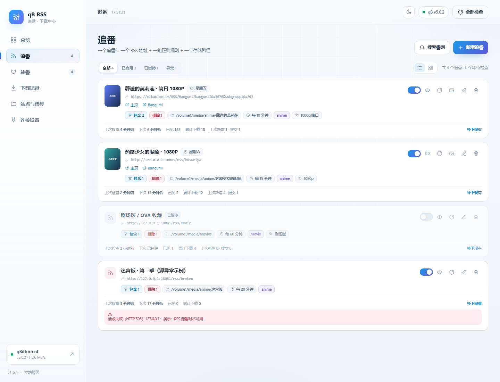
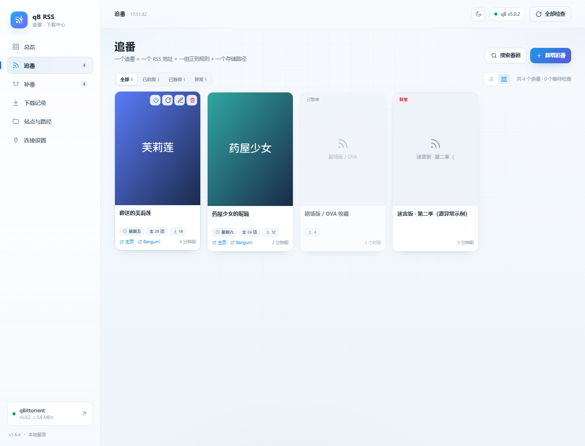
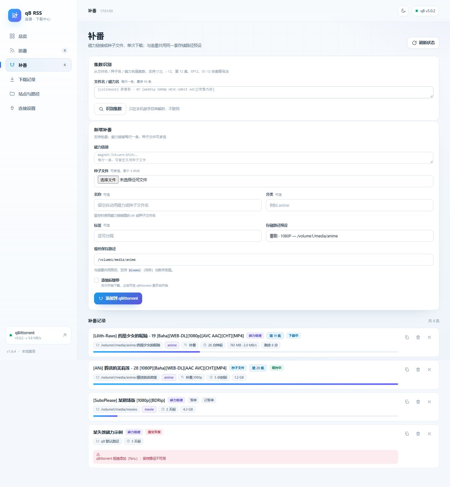
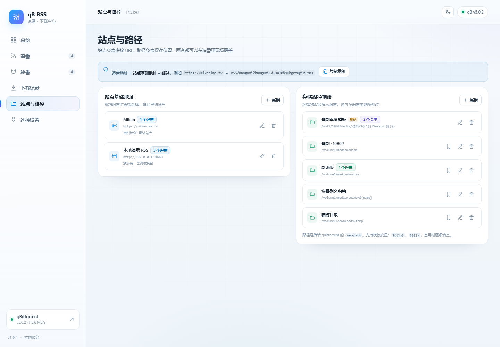
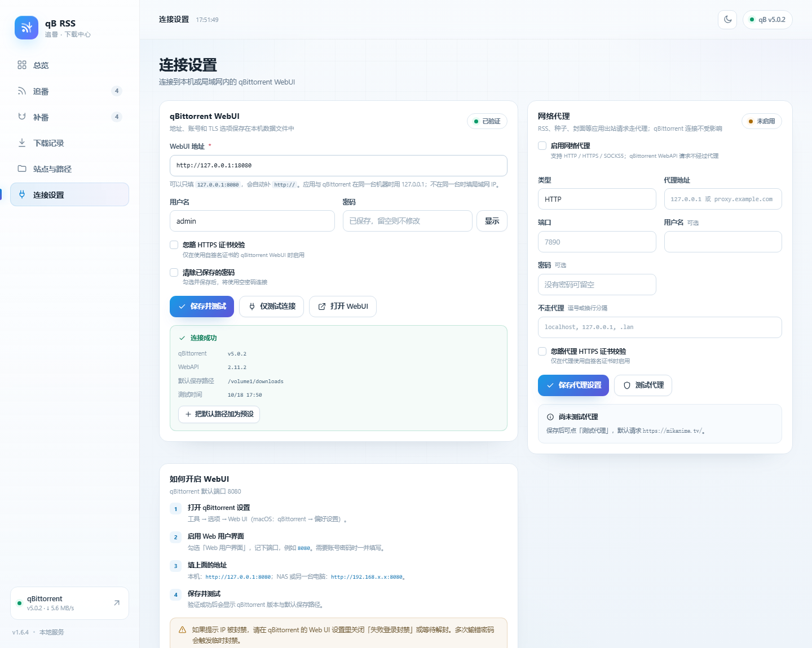
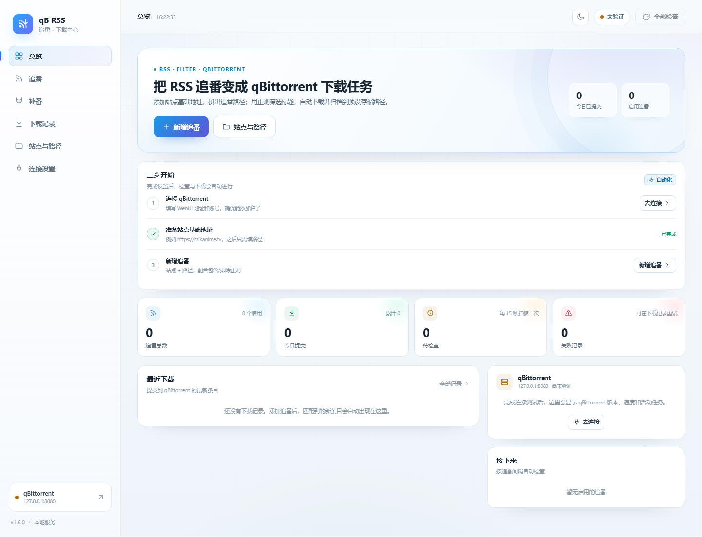
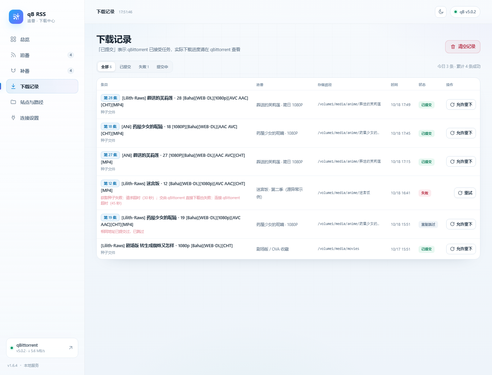
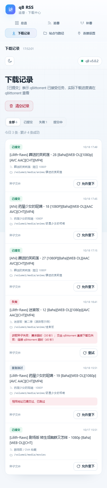

# qB RSS 追番

一个**零 npm 依赖**的本地 Web 应用：把「站点基础地址 + 追番路径」拼成 RSS 地址，用正则筛选标题，自动提交到 qBittorrent，并按预设、模板或现场填写的存储路径归档。

默认**浅色主题**，可切换深色；可独立运行，也可打包成 fnOS（飞牛）应用，在浏览器中通过独立端口打开。


## 功能

- **连接本机 qBittorrent**：WebUI 地址、用户名、密码、自签名 HTTPS 开关；保存时可测试，显示 qB 版本、WebAPI 版本和默认保存路径。
- **网络代理**：支持 HTTP / HTTPS / SOCKS5、代理账号密码、不走代理列表和连通性测试；RSS、种子、封面等应用出站请求可走代理（qBittorrent 连接不受影响）。
- **追番封面与番组信息**：从 Mikan 追番链接推导番组主页（`/Home/Bangumi/<bangumiId>`），抓取封面、放送日期、总集数、官方网站，并提取 bgm.tv 番组链接；追番卡片和预览抽屉可直接显示封面并跳转。
- **站点基础地址预设**：先保存 `https://mikanime.tv` 这类站点根地址；新增追番时只填后面的 `RSS/Bangumi?bangumiId=...`，应用自动拼接。
- **追番名称自动获取**：填写追番地址后自动抓取名称（Mikan 番组名或 RSS 标题），也可以随时手动改；名称会用于路径模板里的 `${name}`。
- **存储路径预设 + 模板变量**：预设可以带变量，例如 `/vol2/1000/media/动画/${{1}}/Season ${{}}`，或直接用 `${name}` 代表追番名称；套用时只需填写需要的空，应用自动拼成最终路径。也可以现场改。
- **列表 / 封面视图**：追番页可以一键切换列表视图和以封面为主的图标视图，筛选、暂停、检查、编辑、预览都不受影响。
- **包含 / 排除正则**：每行一条、默认忽略大小写、排除优先；表单下方有常用表达式快捷按钮，点击即追加；保存前可「预览匹配」，不会产生下载。
- **追番管理**：新增、编辑、删除、暂停/启用、立即检查、清空已见记录；每个追番独立设置检查间隔和单次最多提交数。
- **自动检查**：应用运行期间按间隔轮询，只下载新增且匹配的条目；首次添加默认只记录现有条目，不补下历史。
- **搜索番剧快速追番**：在配置好的站点里搜番剧名，选中番剧和发布组（字幕组）后自动填好站点、追番地址和名称，只需确认正则与路径。
- **补番（磁力 / 种子单次下载）**：粘贴磁力链接（支持多行）或选择 `.torrent` 文件，共用追番的存储路径预设，一次提交到 qBittorrent；记录列表可看进度、刷新状态、删除记录或连任务一起删除。
- **下载记录**：成功、失败、重复跳过；失败可重试；同一条目、同一 RSS 地址不会重复提交。
- **qBittorrent 状态面板**：版本、上下行速度、当前活动任务。
- **浅色 / 深色主题**：默认浅色，右上角太阳/月亮按钮切换，选择保存在浏览器本地。
- **移动端适配**：手机宽度下自动切换卡片式布局。
- **fnOS 浏览器入口**：桌面图标用系统浏览器打开 `http://<NAS-IP>:18181/`，不再嵌在 fnOS 桌面窗口里。
- **配置导出**：导出 JSON 备份（不包含 qBittorrent 密码）。

> 以下截图使用仓库自带的演示数据（`/volume1`、`/vol2` 为占位路径）。












## 与 qBittorrent 自带 RSS 的区别

本应用**不使用** qBittorrent 自带的 RSS 下载器：

- RSS 由本应用轮询，匹配后通过 WebAPI 把 `.torrent` 上传给 qBittorrent（磁力链接直接提交），因此可以做预览、历史记录、正则调试和失败重试。
- 代价是**应用需要保持运行**。fnOS 上由应用生命周期托管；独立运行时需要自己守护进程。
- qBittorrent 的 RSS 标签页里不会自动出现这些追番。如果希望 qB 自己轮询，需要在 qB 内单独配置。

## 快速开始

### 方式一：fnOS（飞牛）应用

安装包：`dist/qbrss-1.6.4.fpk`。

1. 在 fnOS 应用中心开启「手动安装」（如未开启）。
2. 安装 `qbrss-1.6.4.fpk`；应用依赖 `nodejs_v24`，应用中心会处理。
3. 点击桌面上的「qB RSS 追番」，系统浏览器会打开 `http://<NAS-IP>:18181/`。
4. 进入「连接设置」，填写 qBittorrent WebUI 地址并测试连接。
5. 进入「追番」，选择 Mikan 站点、填写路径和正则，保存即可。

命令行安装：

```bash
appcenter-cli install-fpk qbrss-1.6.4.fpk
```

首次打开会看到三步引导：



数据目录：`$TRIM_PKGVAR/config.json`，通常是 `/vol1/@appdata/qbrss/config.json`。卸载时默认保留数据，可在卸载向导里选择删除。

> 应用入口默认仅管理员可见（`allUsers: false`）。独立端口本身**不经过 fnOS 登录态**，安全注意事项见下文。

### 方式二：本机独立运行（Windows / Linux / macOS）

需要 Node.js 18 或更新版本。

```bash
# Windows：双击 start.cmd，或
node app/server/index.js

# Linux / macOS
bash start.sh
```

默认打开 <http://127.0.0.1:8777>。

环境变量：

| 变量 | 默认 | 说明 |
| --- | --- | --- |
| `QBRSS_PORT` | `8777`（独立运行）/ `18181`（fnOS） | 监听端口；设为 `0` 可关闭 TCP |
| `QBRSS_HOST` | `127.0.0.1`（独立）/ `0.0.0.0`（fnOS） | 监听地址。改成 `0.0.0.0` 前请阅读「安全」 |
| `QBRSS_DATA` | `./data` | 配置与历史数据目录 |
| `QBRSS_SOCKET` | 空 | Unix Socket 路径；单独设置时仅监听 Socket，同时设置 `QBRSS_PORT` 可同时开 TCP |

```bash
QBRSS_DATA=./data QBRSS_PORT=8777 node app/server/index.js
```

## 使用流程

### 1. 连接 qBittorrent

在 qBittorrent 中打开：**工具 → 选项 → Web UI**，启用 Web 用户界面，记下端口（默认 `8080`）。

- 应用和 qBittorrent 在同一台机器 / NAS：`http://127.0.0.1:8080`
- qBittorrent 在另一台机器：`http://192.168.x.x:8080`，并确认 qB 允许局域网访问
- 使用 HTTPS 自签名证书：勾选「忽略 HTTPS 证书校验」

点击「保存并测试」。验证成功后会显示 qB 版本、WebAPI 版本和默认保存路径，可以一键把默认路径加为预设。

> 连续输错密码可能触发 qBittorrent 的「失败登录封禁」。遇到 `403` 或封禁提示时，在 qB Web UI 设置里关闭失败登录封禁，或等待解封。


### 2. 添加站点基础地址

进入「站点与路径 → 站点基础地址」，例如：

```text
名称：Mikan
地址：https://mikanime.tv
```

默认已经带了一个可编辑/删除的 Mikan 预设。

追番地址 = 基础地址 + 路径。以你给的例子：

```text
基础地址：https://mikanime.tv
路径：RSS/Bangumi?bangumiId=3870&subgroupid=203
最终地址：https://mikanime.tv/RSS/Bangumi?bangumiId=3870&subgroupid=203
```

如果不想用预设，也可以在新增追番里切到「完整 URL」，直接粘贴整条地址。

### 3. 新增追番


- **追番名称**：填写追番地址后自动获取，也可以在输入框里改成自己喜欢的名字，例如「某番剧 · 简日 1080P」。
- **追番地址**：站点预设 + 路径，或完整 URL。表单会实时显示最终地址。
- **包含正则**：任意一条命中才下载；留空 = 全部。下方有常用表达式快捷按钮。
- **排除正则**：任意一条命中就跳过，优先级高于包含。
- **存储路径**：选择预设会填入输入框；模板里的 `${name}` 自动替换成追番名称；带数字变量的模板会显示变量输入框；留空交给 qBittorrent 默认路径。
- **分类 / 标签**：可选，直接传给 qB。
- **检查间隔**：1–1440 分钟；默认 10 分钟。
- **单次最多提交**：防止一次刷屏，默认 5 条。
- **立即下载当前匹配的现有条目**：默认不勾选。不勾选时，第一次检查只把现有条目记为「已见」，之后只下载新增内容。

保存时会立即拉取一次 RSS 并记录现有条目，然后按间隔自动检查。

### 4. 预览与手动下载

在追番卡片上点眼睛图标：

- 查看 RSS 当前条目、匹配/排除原因、是否已见、是否已提交。
- 点「下载」可手动提交单条，即使它没命中正则。
- 点「立即检查并下载」会按当前规则处理新条目。
- 预览本身不会标记已见，也不会产生下载。



手机宽度下，表格会自动切换为卡片列表：



## 追番名称与封面视图

**追番名称**在填写追番地址后自动获取：

- Mikan 追番（`RSS/Bangumi?bangumiId=...`）优先用番组主页标题，例如 `FX战士久留美`；
- 其他 RSS 用清理掉站点前缀/后缀的源标题，例如 `Mikan Project - 某番剧` → `某番剧`；
- 获取过程中会显示「正在从追番地址获取名称…」，成功后显示「已从追番地址获取：…」；失败也不影响保存，手动填写即可；
- 名称输入框始终可编辑，手动改过之后就不会再被自动覆盖。

追番页右上角可以在**列表视图**和**封面视图**之间切换：

- 列表视图：原有的一行式卡片，信息最全；
- 封面视图：以封面为主体的网格，显示番组名、放送星期、总集数、累计下载、番组主页 / Bangumi 链接和上次检查时间；底部一行保持和列表视图一致的信息；鼠标悬停（移动端常驻）出现右上角操作：启用/暂停（电源图标，暂停时变灰）、立即检查、编辑、删除，点卡片其他地方打开预览抽屉；
- 筛选（全部 / 已启用 / 已暂停 / 异常）对两种视图都生效，选择会记在浏览器本地。

如果封面还没有抓到，封面视图会显示占位图标和番组名；点追番卡片上的图片按钮可以手动刷新封面/番组信息。

## 存储路径模板

在「站点与路径 → 存储路径预设」新增路径时，可以把变化的部分写成变量：

```text
名称：番剧季度模板
路径：/vol2/1000/media/动画/${{1}}/Season ${{}}
```

支持以下写法：

| 写法 | 说明 |
| --- | --- |
| `${1}`、`${2}` | 推荐写法，按编号填写 |
| `${{1}}`、`${{2}}` | 兼容写法 |
| `${{}}`、`{{}}` | 匿名变量，按出现顺序自动编号 |
| `${name}`、`${{name}}` | 追番名称，自动替换；`/`、`\`、`:` 等非法字符会换成 `_` |

套用这个预设时，追番表单会出现「变量 1」「变量 2」两个输入框：

```text
名称：番剧季度模板
路径：/vol2/1000/media/动画/${{1}}/Season ${{}}

变量 1：葬送的芙莉莲
变量 2：01
最终路径：/vol2/1000/media/动画/葬送的芙莉莲/Season 01
```

也可以直接用追番名称：

```text
路径：/vol2/1000/media/动画/${name}/Season 1
追番名称：葬送的芙莉莲
最终路径：/vol2/1000/media/动画/葬送的芙莉莲/Season 1
```

`${name}` 不占变量编号，可以和 `${1}` 混用；**变量输入框里写 `${name}` 也会被替换**（例如模板是 `/media/${1}/Season 1`，变量 1 填 `${name}`，最终就是 `/media/葬送的芙莉莲/Season 1`）。模板里的 `${name}` 会在追番名称变化时实时重算；手动输入最终路径时写 `${name}` 也会替换。带变量的模板会锁定最终路径输入框，避免手改和变量冲突；点「改为自定义」可以退出模板模式，直接编辑最终路径。模板可以设为默认路径，新增追番时会自动展开变量输入框。

> 路径最终作为 qBittorrent 的 `savepath`。Docker 版要填**容器内路径**，不是宿主机路径。
> 编辑路径预设不会改动已创建追番的保存路径；修改站点基础地址会同步使用该站点的追番 URL。

## 正则写法

每行一条，使用 JavaScript 正则语法，**不要写 `/.../` 分隔符**。默认忽略大小写；以 `#` 开头的行会被忽略。

| 目的 | 正则示例 |
| --- | --- |
| 只要 1080p | `1080p` |
| 简日或繁日 | `简日|繁日` |
| 第 1–12 集 | `\[(0?[1-9]|1[0-2])\]` |
| 排除合集 / SP / OVA | `合集|SP|OVA`（填在排除框） |
| 排除预告 | `预告|PV` |
| 匹配多个字幕组 | `Lilith|ANi|桜都` |

表单里的「常用包含 / 常用排除」按钮可以直接追加，包括 `1080p`、`720p`、`简日|繁日`、`Baha|WEB-DL`、`合集|SP|OVA`、`NCOP|NCED` 等。

匹配范围是**标题**（`<title>`）。包含框为空表示全部通过；排除框永远优先。

建议先在表单里点「预览匹配」，确认命中数量再保存。

## 自动检查、去重与失败处理

- 调度器每 15 秒扫描一次到期追番，最多同时检查 2 个；每个追番按自己的间隔计算下次检查时间。
- 已见记录按条目的 `guid` / `id` / 链接 / 标题+日期生成 key，保存在本机 `config.json`，不会重复下载同一集。
- 同一个种子 URL 已经成功提交过时，跨追番也会跳过（记为「重复跳过」）。
- 添加前会解析 `.torrent` 的 infohash 并查询 qBittorrent；qB 里已有同一种子时直接标记「重复跳过」，不再误报失败。磁力链接也会解析 infohash。
- qBittorrent 返回 `Fails.` 时，错误记录会带上当前保存路径/分类，并提示检查路径是否在 qB 侧存在且可写。
- 会先校验下载到的内容确实是 `.torrent`；如果内容无效，或 qB 拒绝文件上传，会自动改用 URL 交给 qBittorrent 直接抓取一次。日志会记录 infohash 和 qB 请求形态，便于定位。
- qBittorrent 不可用时，本次检查**不会**把匹配新条目标记为已见，下个周期会自动重试，避免漏集。
- 单次超过「最多提交」的匹配项会留到下次检查，不会丢。
- 提交失败会写入下载记录；点「重试」重新提交。
- 「已提交」只代表 qBittorrent 接受了任务，实际下载进度请在 qBittorrent 查看。
- 清空已见记录会让历史条目重新参与匹配，**并且让该追番的旧下载记录退出去重**，所以可以重新下载；这是 1.6.4 修复的行为。
- 清空下载记录只删除本应用的历史，不会重置追番的已见记录；清空后这些条目同样不再参与去重。

### 在 qBittorrent 里删了任务，想重新下载

去重分三层（已见记录、同一 URL 的下载记录、qB 里的 infohash）。在 qB 里删掉任务后，qB 那层已经不拦，但前两层仍然会拦，所以需要显式放行，任选一种：

| 做法 | 位置 | 效果 |
| --- | --- | --- |
| **重新下载** | 追番预览抽屉里该条目的按钮 | 只放行这一条，忽略本应用的下载记录，立刻再提交一次（qB 里仍有同种子时会提示重复） |
| **允许重下** | 下载记录里该条记录的按钮 | 只放行这一条记录，之后下一次检查 / 手动提交即可重新下载 |
| **清空已见记录** | 编辑追番 → 勾选「清空已见记录」并保存 | 该追番所有历史条目重新参与匹配，旧下载记录一并退出去重 |
| **补下现有** | 追番卡片上的「补下现有」 | 同上，并立即检查、下载当前匹配的现有条目 |

> 说明：`重新下载` 与 `允许重下` 都只影响本应用的判断，不会去动 qBittorrent 里的任务；qB 里确实存在同 infohash 时仍然会按重复跳过。

### 补下现有匹配

首次添加追番默认只记录现有条目，不会补下历史。之后如果想把当前 RSS 里已有的匹配条目补下来：

- 在追番卡片右下角点 **「补下现有」**；
- 确认后会重置该追番的已见记录与该追番的下载去重记录，并立即检查、下载当前匹配的现有条目；
- qBittorrent 里已经存在同种子的仍会跳过；
- 仍然受「单次最多提交」限制，超出的部分留到下次检查。

新增追番时也可以直接勾选「立即下载当前匹配的现有条目」，这样创建后就会补下现有匹配。

## 网络代理

在「连接设置 → 网络代理」里配置，支持：

- **HTTP / HTTPS**：用于访问被网络限制的 RSS 站点；HTTPS 代理可单独忽略证书校验。
- **SOCKS5**：域名交给代理解析。
- **账号密码**：可选，保存在本机数据文件；界面只显示是否已保存，不回传明文。
- **不走代理**：逗号或换行分隔，例如 `localhost, 127.0.0.1, .lan`；匹配域名后缀。
- **测试代理**：默认请求 `https://mikanime.tv/`，显示 HTTP 状态、大小和耗时。

代理只作用于本应用的出站请求（RSS 拉取、种子下载、封面/番组信息抓取）；qBittorrent WebAPI 请求仍直连，避免把本机 qB 连接绕出去。

## 追番封面与番组信息

如果追番地址是 Mikan 的 `RSS/Bangumi?bangumiId=4059` 形式，应用会自动推导：

```text
追番：https://mikanime.tv/RSS/Bangumi?bangumiId=4059&subgroupid=203
主页：https://mikanime.tv/Home/Bangumi/4059
```

从主页抓取并保存：

- 封面（`.bangumi-poster` 背景图），通过 `/api/cover/<subId>` 同源代理展示，避免防盗链和混合内容；
- 番组标题、放送日期、总集数、放送开始；
- 官方网站；
- Bangumi 番组计划链接（`https://bgm.tv/subject/<id>`）。

追番卡片会显示封面缩略图和「主页 / Bangumi」链接；预览抽屉显示大封面和官网链接。元数据缺失或超过 7 天会在检查后自动刷新，也可以点追番卡片上的图片按钮手动刷新。这些信息保存在本机配置里，供后续扩展（评分、集数进度、跳转下载页等）使用。

## 搜索番剧（快速追番）

在追番页点「搜索番剧」，选择站点、输入番剧名，应用会去站点搜索：

1. 先用站点的 RSS 搜索接口找到匹配的单集；
2. 并发读取这些单集页面，解析出所属番剧（bangumiId）、封面和字幕组（subgroupId）；
3. 再读番组主页补齐字幕组名称、放送星期、总集数、Bangumi 链接；
4. 结果按命中集数排序，每个发布组是一个按钮，显示命中的集数。

点某个发布组后，应用会自动打开「新增追番」表单，并填好站点基础地址、追番地址 `RSS/Bangumi?bangumiId=…&subgroupid=…` 和番剧名称；你只需要确认正则和存储路径，点「创建追番」即可。

每个发布组显示的是**该字幕组实际已发布的集数**：先统计番组主页当前列出的集数，再拉取该字幕组的 RSS 校正（主页只列最近若干集，RSS 才能拿到完整列表）；同一集的多个版本（简/繁、不同分辨率）只算一集。鼠标悬停可以看到收录的集数区间（如 `收录：第 1-12 集`）和本次匹配条数。搜索结果卡片上的「本次匹配 N 条」代表这次搜索在站点里命中的单集数量。


目前站点搜索支持 Mikan 系站点（Mikan / 蜜柑计划及其镜像）；其他站点仍可手动填写追番路径。搜索结果有 5 分钟缓存，重复搜索同一关键词不会反复请求站点。

## 集数识别

标题里没有统一规范，应用内置了一套集数猜测规则，支持这些常见写法：

| 写法 | 例子 | 识别结果 |
| --- | --- | --- |
| 方括号数字 | `[12]`、`[12v2]` | 第 12 集 |
| 横线/空格分隔 | `某番剧 - 07 [1080p]` | 第 7 集 |
| 中文 | `第12集`、`第 12 话` | 第 12 集 |
| 英文前缀 | `EP12`、`E12`、`S02E05` | 第 12 / 5 集 |
| 合集区间 | `[01-12合集]` | 第 1–12 集（合集） |
| 特别篇 | `NCOP`、`OVA`、`SP01` | 特别篇 |

会自动排除分辨率（1080p/720p）、年份（2025 年 10 月番）、bit/fps 这类数字，避免把 `1080p` 当成集数。

识别结果会显示在：

- **补番页的「集数识别」小工具**：粘贴文件名、种子名或磁力名，每行一条，立刻给出每条的集数；
- **补番记录**：标题旁显示「第 7 集」这样的标签；
- **追番预览抽屉**：每条条目显示集数标签；
- **下载记录**：条目旁显示集数标签。

识别只在本机做字符串解析，不联网；规则覆盖大多数常见命名，命名太随意时可能识别不出，会显示为未识别。

## 补番（磁力 / 种子单次下载）

「补番」用于不成套的单次下载，和追番共用同一套存储路径预设：

- **磁力链接**：可一次粘贴多条，每行一条；
- **种子文件**：可多选 `.torrent`（单个 ≤ 8MB），前端转成 base64 提交；
- **名称**：留空时自动使用磁力链接里的 `dn` 参数或种子文件名；
- **存储路径**：选择追番用的路径预设；普通预设直接填入，带变量的模板会展开变量输入框；也可以选「自定义」或留空使用 qBittorrent 默认路径；
- **分类 / 标签 / 添加后暂停**：按需填写；
- 添加后会记录 infohash：qBittorrent 里已有同种子、或补番记录里已有同种子时会直接拒绝，不会重复下载。

记录列表显示任务状态（下载中 / 做种中 / 已暂停 / 校验中 / 出错）、进度条、大小、速度、剩余时间和保存路径：

- 「刷新状态」从 qBittorrent 批量拉取这些 infohash 的最新状态；
- 垃圾桶 = 只删除补番记录，qB 任务保留；
- × = 同时删除 qBittorrent 任务和已下载文件（会二次确认）。


## 数据、备份与安全

### 数据位置

- fnOS：`$TRIM_PKGVAR/config.json`
- 独立运行：`$QBRSS_DATA/config.json`，默认 `./data/config.json`

`config.json` 包含追番、已见记录、下载历史、站点/路径预设和 qBittorrent 连接信息。文件以 `0600` 写入（Linux）。

### 安全设计

- 独立运行默认只监听 `127.0.0.1`，没有内置登录。
- fnOS 版本现在通过**独立端口 18181** 打开，方便浏览器访问，但**不经过 fnOS 登录态**：任何能访问该端口的人都可以修改追番和连接设置。请只在可信内网使用，不要做公网端口映射；建议在 NAS 防火墙中限制来源网段。
- 若要从公网访问，请在前面加带认证的反向代理（HTTPS），不要直接暴露 18181。
- qBittorrent 密码和代理密码都以明文保存在本机配置文件中，请保护数据目录。
- 「导出配置」不包含 qBittorrent 与代理密码；导出的 JSON 仍包含追番、路径和番组信息，请妥善保管。
- 写接口会拒绝浏览器发起的跨站写请求（`Sec-Fetch-Site: cross-site`），降低 localhost CSRF 风险。
- 所有 RSS 标题、链接和错误信息在渲染前都会 HTML 转义；外部链接使用 `noopener`。
- 建议为 qBittorrent 单独设置一个权限受限的 WebUI 账号，不要在公网直接暴露 qB WebUI。

### 修改 fnOS 访问端口

如果 18181 被占用，需要同时改三处并重新打包：

1. `manifest` 的 `service_port`
2. `app/ui/config` 的 `port`
3. `cmd/main` 中 `QBRSS_PORT` 的兜底值（或设置环境变量）

### 多用户

fnOS 入口默认仅管理员可见（`app/ui/config` 中 `allUsers: false`），但直接端口访问不受该限制。本应用不做多用户数据隔离；如果需要家庭共用，请配合网络访问控制。

## 常见问题

**登录返回 403 / IP 被封禁**
：qBittorrent 对失败登录有临时封禁。关闭「失败登录封禁」或等待；确认用户名密码和 WebUI 端口。

**提示「返回的是网页而不是 RSS/Atom」**
：该地址被 Cloudflare/登录页/错误页拦截，或者不是 RSS。用浏览器直接打开确认返回 XML；需要登录的站点请换公开 RSS 地址。

**qBittorrent 拒绝添加（Fails.）**
：常见原因是同一种子已存在、分类不存在或保存路径不可写。应用会把它记为失败，可在下载记录查看错误。

**点击 fnOS 图标浏览器打不开**
：确认 NAS 的 18181 端口未被防火墙拦截；如果端口被其他程序占用，应用会启动失败，查看 `/var/apps/qbrss/var/app.log` 并修改端口。

**获取种子失败，但 qB 能下**
：应用会先尝试自己下载 `.torrent`，失败时自动改为把 URL 交给 qBittorrent 直接抓取。若两者都失败，检查 qB 的网络、代理和站点防盗链。

**路径模板没有出现变量输入框**
：检查预设路径中是否包含 `${1}`、`${{1}}` 或 `${{}}`；只有 `${name}` 时不会出现变量输入框，但会自动使用追番名称。编辑预设后重新在追番表单中套用。

**fnOS 应用启动失败**
：查看 `/var/apps/qbrss/var/app.log`；确认 `nodejs_v24` 依赖已安装、18181 端口空闲。也可以在应用中心停止后重新启动。

## 开发与测试

零 npm 依赖，只需要 Node.js 18+。

```bash
# 单元测试：RSS 2.0 / Atom / 正则 / URL 拼接
node dev/unit.js

# 端到端烟测：内置假 qB + 假 RSS，覆盖追番、正则、去重、失败重试
node dev/smoke.js

# 或
npm test
```

烟测会占用 `8788`、`18080`、`18081` 端口，并在 `work/qbrss-smoke-data` 生成临时数据。

### 本地演示数据

```bash
node dev/demo.js
# 另开终端：
QBRSS_DATA=../work/qbrss-demo-data QBRSS_PORT=8777 node app/server/index.js
```

演示数据包含假 qBittorrent、假 RSS、4 个追番、4 条补番记录、5 个路径预设（含 `/vol2/1000/media/动画/${{1}}/Season ${{}}` 和 `${name}` 模板）和 6 条下载记录；假 RSS 还提供搜索接口、单集页和番组主页，方便调试「搜索番剧」。`dev/demo.js` 只用于开发演示，不会进入 FPK。

### 打包 fnOS FPK

```powershell
$env:TMP="D:\workspace\fnos\work\tmp"
D:\workspace\fnos\tools\fnpack.exe build -d D:\workspace\fnos\qbrss
python qbrss\dev\repack-fpk.py qbrss.fpk qbrss-1.6.4.fpk
```

`fnpack` 在 Windows 上会把 `cmd/*` 写成 `0666`；`repack-fpk.py` 只重写外层 tar，把生命周期脚本改成 `0755`，不会改动 `app.tgz`，因此 `manifest.checksum` 仍有效。

构建后用 `tar -tzf` 检查顶层结构：`app.tgz`、`manifest`、`cmd/`、`config/`、`wizard/`、两个图标。

## 目录结构

```text
qbrss/
├── app/
│   ├── server/         # Node.js 后端（HTTP、RSS、qB、调度、存储）
│   ├── www/            # 原生 HTML/CSS/JS 前端 + 主题初始化
│   └── ui/             # fnOS 桌面入口配置与图标
├── cmd/                # fnOS 生命周期脚本
├── config/             # fnOS privilege / resource
├── wizard/             # 卸载向导
├── docs/               # README 截图
├── dev/                # 单元测试、烟测、假 qB/RSS、截图脚本
├── manifest            # fnOS 应用元数据
├── ICON.PNG            # 64×64
├── ICON_256.PNG        # 256×256
├── start.cmd / start.sh
├── package.json
└── README.md
```

## 后端接口

| 方法 | 路径 | 说明 |
| --- | --- | --- |
| GET | `/api/state` | 全量状态（追番、预设、统计、最近下载、日志） |
| POST | `/api/qb/test` | 测试 qBittorrent 连接 |
| PUT | `/api/qb/config` | 保存连接配置 |
| GET | `/api/qb/status` | qB 版本、速度、活动任务 |
| PUT | `/api/proxy` | 保存网络代理配置 |
| POST | `/api/proxy/test` | 通过当前/表单代理测试请求 |
| GET | `/api/cover/:id` | 同源代理追番封面图片 |
| POST | `/api/subs/:id/meta` | 刷新追番的封面/番组信息 |
| POST | `/api/resolve` | 从追番地址解析名称 / 番组信息，不落库 |
| POST | `/api/guess-episode` | 从文件名/种子名猜集数（最多 50 行） |
| GET | `/api/search` | 在站点搜索番剧与发布组（`q`、`baseId`、`limit`） |
| GET | `/api/image` | 同源代理搜索结果封面（仅允许配置站点与 Mikan/bgm 域名） |
| GET/POST | `/api/extras` | 补番记录列表 / 新增磁力链接 |
| POST | `/api/extras/upload` | 新增种子文件（base64） |
| POST | `/api/extras/status` | 批量刷新补番任务状态 |
| DELETE | `/api/extras/:id` | 删除补番记录；`?deleteTorrent=1&deleteFiles=1` 同时删除 qB 任务与文件 |
| POST | `/api/preview` | 预览任意 RSS + 正则，不落库 |
| GET/POST | `/api/subs` | 追番列表 / 新增 |
| PUT/DELETE | `/api/subs/:id` | 修改 / 删除 |
| POST | `/api/subs/:id/check` | 立即检查并提交新匹配 |
| POST | `/api/subs/:id/preview` | 预览该追番 |
| POST | `/api/subs/:id/download` | 手动下载某条 |
| POST | `/api/subs/:id/toggle` | 暂停 / 启用 |
| POST | `/api/subs/:id/reset` | 清空已见记录 |
| GET/DELETE | `/api/downloads` | 下载记录 / 清空 |
| POST | `/api/downloads/:id/retry` | 重试失败记录 |
| GET | `/api/export` | 导出配置（不含密码） |

所有接口都基于同源访问，没有额外的 API Token。独立端口不要把 18181 直接暴露到公网。

## 限制

- 只按标题匹配，不解析简介、字幕组字段或集数范围。
- 不做多用户隔离，也没有内置登录（依赖本机回环、网络控制或反向代理）。
- 不把追番同步到 qBittorrent 自带 RSS 列表。
- 应用停止运行期间不会检查 RSS；重新启动后由调度器继续。
- 路径模板只在前端展开成最终 `savepath`，不会保存变量本身；修改预设不会回改已有追番；`${name}` 在保存时替换为当时的追番名称，之后改名不会自动改已有追番的路径，需要重新保存追番。
- 站点搜索只支持 Mikan 系站点，依赖站点的 RSS 搜索与页面结构；站点改版可能导致搜索失效，此时手动填写追番路径仍然可用。
- 补番记录里的种子文件不会保存在应用数据里（只记录 infohash、文件名和路径），需要重新上传才能再次提交。
- 依赖 Node.js 18+ 和 qBittorrent WebAPI v2（qB 4.x / 5.x）。

---

版本：1.6.4
